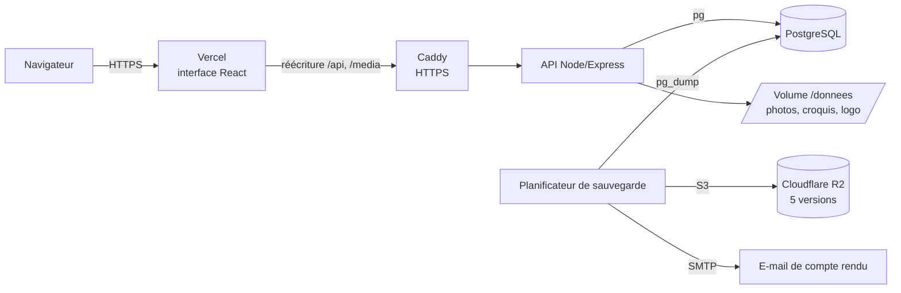
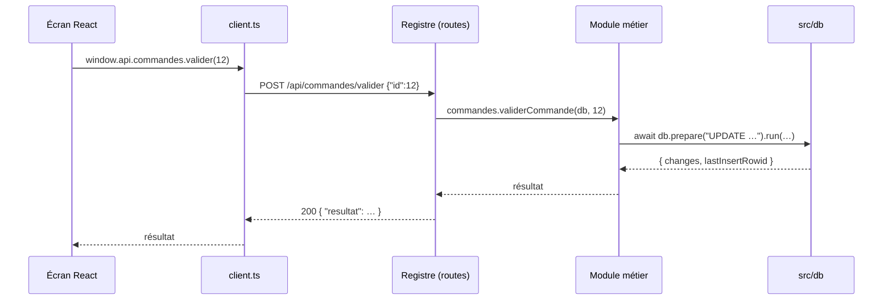

# Architecture

## Vue d'ensemble



- **Interface** (`apps/web`) : l'application React de la v1.0.1, quasiment inchangée. Les écrans appellent toujours `window.api.<espace>.<methode>(…)`. C'est `src/api/client.ts` qui construit cet objet au-dessus de l'API HTTP.
- **API** (`apps/api`) : Express. Elle ne contient aucune logique dans les routes : chaque route appelle une fonction métier de `src/modules`.
- **Base** : PostgreSQL 16+ (Neon ou conteneur sur le serveur, au choix ; seul `DATABASE_URL` change).
- **Fichiers** : sur le volume `/donnees/fichiers` du serveur. L'arborescence (`images/commandes`, `images/fiches-techniques`…) est celle de l'ancien dossier `%APPDATA%\belvie-erp`, et les chemins enregistrés en base n'ont pas changé.

## Parcours d'une requête



## Le registre des routes : source unique

`apps/api/src/routes/registre.js` contient une ligne par fonction exposée (261 aujourd'hui) :

```js
{ espace: "commandes", methode: "valider", lecture: false, params: ["id"], appel: (db, id) => commandes.validerCommande(db, id) },
```

À partir de ce fichier :
- les routes Express sont montées automatiquement (`GET` pour les lectures, `POST` pour les écritures) ;
- le client du navigateur est généré (`apps/web/src/api/routes.generated.ts`) ;
- la documentation de l'API est générée (`docs/api.md`).

La CI vérifie que les fichiers générés sont à jour. Une route ne peut donc pas exister côté interface sans exister côté API, et inversement.

Les **lectures** passent par des connexions PostgreSQL ouvertes en `default_transaction_read_only` : une route GET ne peut rien modifier, même par erreur.

## La couche d'accès à la base (`apps/api/src/db/index.js`)

Le code métier a été écrit pour better-sqlite3 (synchrone). Plutôt que de le réécrire, on a gardé **la même forme d'appel, en asynchrone** :

```js
const ligne = await db.prepare("SELECT * FROM articles WHERE id = ?").get(id);
const tx = db.transaction(async (x) => { … });   await tx(x);
```

Cette couche est le **seul** endroit qui connaît PostgreSQL. Elle :
1. traduit les paramètres `?` et `@nom` en `$1, $2…` ;
2. ajoute `RETURNING id` aux INSERT, pour fournir `lastInsertRowid` ;
3. fait passer toutes les requêtes d'une transaction par la même connexion, y compris celles qui utilisent la variable `db` capturée (AsyncLocalStorage), et gère les transactions imbriquées par SAVEPOINT ;
4. trie les NULL comme SQLite (`NULLS FIRST` en ordre croissant), parce que tout le code métier a été écrit et validé avec ce comportement.

## Choix de la phase 1 : iso-fonctionnel

La migration vise à **ne rien changer au comportement métier**. Concrètement :
- les dates restent en `TEXT` au format SQLite (`AAAA-MM-JJ HH:MM:SS`, UTC) ; `maintenant()` et `aujourdhui()` remplacent `datetime('now')` et `date('now')` ;
- les booléens restent des entiers 0/1 ;
- le code métier a été converti mécaniquement (`tools/codemod`), puis corrigé uniquement là où les tests montraient un écart.

**Preuve** : les tests différentiels (`apps/api/test/differentiel`) exécutent chaque appel à la fois sur le code Electron d'origine (SQLite, tag `electron-1.0.1`) et sur le nouveau code (PostgreSQL), puis comparent les résultats. Sur une copie de la base réelle, les 954 lectures donnent des résultats identiques. Les écritures sont couvertes par les scénarios `scenario-*.test.js`.

Les améliorations de modèle (vrais types `timestamptz`/`boolean`, opérateur lié au compte connecté…) viendront ensuite, une à une, chacune avec sa migration et ses tests. Voir [migration-electron-vers-web.md](migration-electron-vers-web.md).

## Sécurité

- Comptes locaux : mots de passe hachés (bcrypt) ; sessions par cookie `HttpOnly`, `SameSite=Lax`, `Secure` en production. La base ne garde que l'empreinte SHA-256 du jeton de session.
- Protection CSRF : toute requête d'écriture doit porter l'en-tête `X-Belvie: 1`.
- Tentatives de connexion limitées : 10 échecs par IP par quart d'heure.
- Sauvegardes, données de démo, téléchargements de sauvegarde : rôle `admin` uniquement.
- Fichiers : le navigateur ne voit jamais de chemin réel (jetons de téléversement) ; `/media` exige une session et ne sert que le dossier `images/`.
- Secrets : uniquement en variables d'environnement (`.env` sur le serveur, jamais dans Git).
