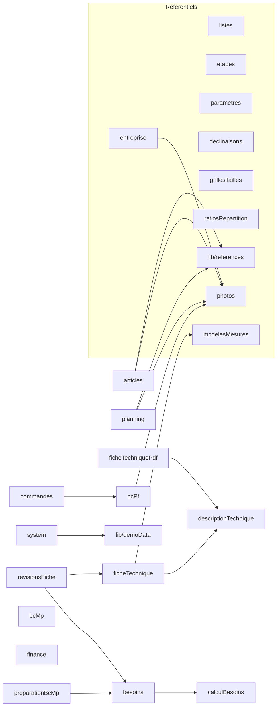

# Documentation par module — Belvie ERP (version web)

Cette documentation décrit chaque module fonctionnel : son rôle, ses règles métier, ses tables, son
code, ses routes d'API, ses écrans, ses tests et ses points ouverts.

- **Référence métier** : les règles (R0.x, RM, RF, RC…) et leurs statuts sont repris du document
  fonctionnel *Belvie ERP — Documentation fonctionnelle et règles métier* (v1.0.1, 14 → 17 octobre
  2026). Un identifiant de règle cité ici renvoie toujours à ce document.
- **Référence de l'API** : [`docs/api.md`](../api.md), généré à partir du registre
  `apps/api/src/routes/registre.js` (ne pas le modifier à la main : `npm run generer --workspace apps/api`).
- **Tableaux de routes** : dans chaque fiche module, ils sont tirés du même registre au moment de
  la rédaction ; en cas de doute, `docs/api.md` fait foi.

## Convention de statut

| Marque | Signification |
|---|---|
| ✅ **Livré** | En place dans le code |
| 🟦 **Décidé** | Règle arrêtée avec le métier, développement à venir |
| 🟨 **Proposé** | Recommandation technique, décision métier encore attendue |
| ⛔ **Écarté** | Option étudiée et volontairement rejetée |

## Index

| Fichier | Module | Code principal (`apps/api/src/modules/`) |
|---|---|---|
| [00-principes-transverses.md](00-principes-transverses.md) | Règles qui s'appliquent partout (R0.1 → R0.7) et leur traduction dans la version web | `src/db/index.js`, `migrations/` |
| [articles-et-referentiels.md](articles-et-referentiels.md) | Articles, listes de valeurs, déclinaisons, grilles de tailles, ratios, étapes, opérateur actif, entreprise, modèles de mesures | `articles.js`, `listes.js`, `declinaisons.js`, `grillesTailles.js`, `ratiosRepartition.js`, `etapes.js`, `parametres.js`, `entreprise.js`, `modelesMesures.js`, `photos.js` |
| [fiches-techniques.md](fiches-techniques.md) | Fiche technique : matières, fournitures, coloris, tailles, mesures, gradations, croquis, description, PDF | `ficheTechnique.js`, `descriptionTechnique.js`, `ficheTechniquePdf.js` |
| [revisions-et-recettes-figees.md](revisions-et-recettes-figees.md) | Révisions de fiche, « Modifier la nomenclature », gel des recettes par production | `revisionsFiche.js`, `besoins.js` (lecture) |
| [commandes-de-production.md](commandes-de-production.md) | Commandes de fabrication, statuts, répartition couleurs × tailles, historique | `commandes.js` |
| [planning.md](planning.md) | Planification des collections (articles prévisionnels) | `planning.js` |
| [bc-produits-finis.md](bc-produits-finis.md) | Bons de commande produits finis (BC PF) et leur PDF | `bcPf.js`, `bcPfPdf.js` |
| [approvisionnement-besoins.md](approvisionnement-besoins.md) | Moteur unique de calcul des besoins, anomalies, engagements non rattachés | `besoins.js`, `calculBesoins.js` |
| [bc-matieres-premieres.md](bc-matieres-premieres.md) | Bons de commande matières premières (BC MP) : préparation, brouillons, numérotation | `preparationBcMp.js`, `bcMp.js` |
| [finance.md](finance.md) | Fournisseurs, tarifs, engagements, réceptions, factures, paiements, échéances, coûts, estimations | `finance.js` |
| [stock.md](stock.md) | Stock dérivé actuel et évolutions prévues | `finance.js` (`stockDisponibleMatiere`…) |
| [systeme-et-exploitation.md](systeme-et-exploitation.md) | Sauvegardes, R2, export, démo, authentification, fichiers ; ce qui a disparu avec Electron | `system.js`, `src/auth.js`, `scripts/` |

## Carte des dépendances entre modules

Une flèche `A --> B` signifie « le code de A appelle le code de B ». Les écrans n'apparaissent pas :
ils passent tous par l'API.

Liens de données sans appel de code (lus directement en SQL) :
- `besoins` lit `achats`, `achats_affectations`, `achats_receptions` (Finance) et `bc_mp_lignes` /
  `bc_mp_ligne_productions` (BC MP) pour le « déjà commandé » et le « en préparation » ;
- `bcMp` et `finance` lisent `fournisseurs` et `prix_fournisseurs` ;
- `commandes` lit la fiche technique de l'article (`ft_matieres`, `ft_matiere_couleurs`) pour
  l'ancien calcul `besoinsMatieres` (voir RB1).

## Où se trouve quoi

| Couche | Emplacement |
|---|---|
| Schéma de base | `apps/api/migrations/001_schema_initial.sql` (+ `002_authentification.sql`, `003_donnees_reference.sql`) |
| Code métier | `apps/api/src/modules/*.js` — une fonction métier reçoit toujours `db` en premier argument |
| Exposition HTTP | `apps/api/src/routes/registre.js` (routes simples), `apps/api/src/routes/speciales.js` (fichiers, PDF, export, sauvegardes) |
| Client navigateur | `apps/web/src/api/client.ts` reconstruit `window.api.<espace>.<methode>` à partir de `routes.generated.ts` |
| Écrans | `apps/web/src/modules/<module>/` |
| Tests de non-régression | `apps/api/test/differentiel/` (ancien code Electron 1.0.1 sur SQLite ↔ nouveau code sur PostgreSQL) |
| Historique de conception | `docs/historique/` (notes de livraison des lots Electron) |
